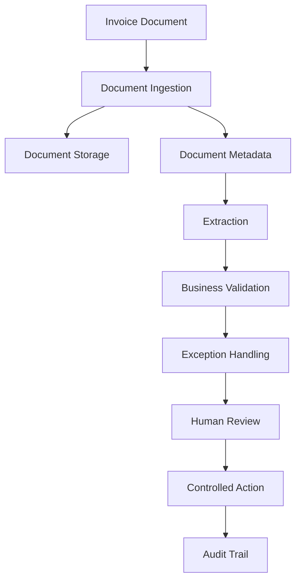

# ExceptionOps AI

### AI-Assisted Invoice Processing and Business Exception Management

ExceptionOps AI is a portfolio project exploring how business automation can support invoice processing, validation, exception handling, human review, and controlled actions.

The project focuses on more than extracting information from documents. It demonstrates the engineering practices needed to build a maintainable business application, including API design, database management, validation, testing, observability, and safe handling of actions.

> **Demo safety:** The public demonstration uses synthetic business data. Document storage can run locally. Simulated actions must not be interpreted as real payments or external transactions.

## Business Problem

Invoice-processing workflows can involve several repetitive tasks:

- Extracting invoice information
- Comparing invoice details with purchase-order information
- Identifying inconsistencies
- Routing exceptions for review
- Recording decisions and action outcomes

A business application must also account for invalid input, duplicate requests, failures, traceability, and data protection.

ExceptionOps AI explores these requirements through a structured invoice-processing workflow.

## Project Goals

- Build a modular Python backend.
- Support document ingestion and processing.
- Validate business data before relying on it.
- Identify invoice-processing exceptions.
- Support review and controlled-action workflows where implemented.
- Maintain database records and audit information.
- Test normal operations and failure paths.
- Keep portfolio data synthetic and reproducible.
- Support local document storage.

## Architecture



The diagram describes the business workflow. Refer to `docs/ARCHITECTURE.md` for component boundaries and limitations. Only claim an individual step as implemented after verifying it in the current code.

## Technology Stack

The project uses the following technologies where included in the current implementation:

- Python
- FastAPI
- SQLAlchemy
- Alembic
- PostgreSQL
- SQLite for isolated tests
- React
- TypeScript
- Pytest
- Docker
- Docker Compose

## Portfolio Demo

The synthetic dataset contains six fictional invoice scenarios:

| Scenario | Demonstration purpose |
|---|---|
| Matched invoice | Illustrates a normal comparison case |
| Amount mismatch | Illustrates inconsistent invoice and purchase-order amounts |
| Duplicate candidate | Illustrates potential duplicate detection |
| Invalid amount | Illustrates data validation |
| Missing purchase order | Illustrates missing business information |
| Supplier mismatch | Illustrates supplier identity inconsistencies |

Generate the dataset:

```powershell
python scripts/generate_synthetic_demo_data.py
```

Dataset documentation is available in `data/synthetic/README.md`.

The expected outcome column describes the intended scenario. It does not independently prove that the application has detected or resolved the exception.

## Local Development

### Prerequisites

Install the tools required by your current setup:

- Python 3.12 or the version supported by `pyproject.toml`
- Git
- Node.js and npm if running the frontend
- Docker Desktop if using Docker Compose
- PostgreSQL if running the database directly rather than in Docker

### Backend setup

Create and activate a virtual environment:

```powershell
python -m venv .venv
.\.venv\Scripts\Activate.ps1
```

Install the project and development dependencies using the command supported by your package configuration:

```powershell
python -m pip install -e ".[dev]"
```

Copy `.env.example` to `.env` and configure the required local settings. Never commit the real `.env` file.

Apply database migrations:

```powershell
alembic upgrade head
```

Start the backend using the command defined by the project:

```powershell
uvicorn app.main:app --reload
```

If you use Docker Compose, follow the local deployment instructions documented for that configuration instead.

### Frontend setup

Navigate to the actual frontend directory and follow its `package.json` scripts.

For a typical npm-based project:

```powershell
npm install
npm run dev
```

Configure the frontend to call the local FastAPI backend using the environment variable expected by the existing frontend code.

## Testing

Run the automated backend test suite:

```powershell
python -m compileall app tests
pytest -q
```

Test the synthetic-data generator:

```powershell
pytest tests/test_synthetic_demo_data.py -q
```

The project should be considered verified only for the tests that actually pass in the current working tree.

## Local Document Storage

The local setup stores uploaded document files on the configured local filesystem.

Document contents and database records are stored separately. Back up both the document directory and the database.

No cloud document-storage service is required for the local demonstration.

## Security and Data Boundaries

- Use synthetic data in the public repository.
- Never commit real customer or employer documents.
- Never commit API keys, passwords, tokens, or private environment files.
- Keep local uploads and database backups outside the public repository.
- Preserve backend upload validation and safe file-path handling.
- Do not expose a local development server directly to the public internet.
- Clearly distinguish simulated actions from real external integrations.

## Project Documentation

- `docs/ARCHITECTURE.md` — architecture and component responsibilities
- `docs/PORTFOLIO_DEMO.md` — demonstration workflow and scenarios
- `data/synthetic/README.md` — synthetic-data policy and generation
- `scripts/generate_synthetic_demo_data.py` — reproducible dataset generation

## Limitations

This is a portfolio project, not a claim of a fully deployed enterprise financial system.

Its supported document formats, extraction accuracy, authentication model, deployment configuration, and external integrations should be assessed from the current implementation.

Simulated actions are not real payments. Automated validation and exception flags do not replace appropriate business approval.

## Future Improvements

Potential future improvements include:

- Additional document formats and extraction evaluations
- More extensive integration testing
- Improved exception analytics
- Additional review and reporting capabilities
- Monitoring and operational dashboards
- Integration with external business systems behind appropriate authorization and safeguards

## Author

**Muqadas Israr**  
AI/ML Engineer | Python | Data Analytics | Business Automation

This project demonstrates an engineering approach to practical business automation, with emphasis on validation, traceability, testing, and safe handling of business data.